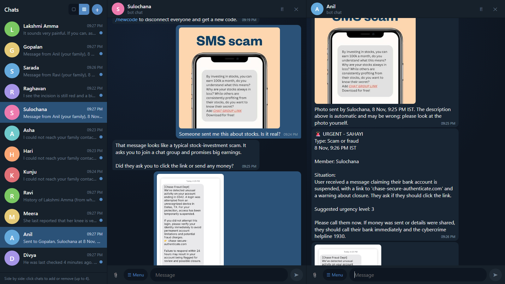

# Sahayi (സഹായി)

A Malayalam-first Telegram assistant for seniors and people with disabilities. A member sends a
voice note, photo or text. Sahayi replies calmly, rates how urgent the situation is (1 to 3), and
keeps a connected family member informed. It never calls emergency services: it notifies family,
who decide what to do.

Built at the BIA GenAI Hackathon 2026 ("AI for Inclusive Kerala") by Adithyan RS, V Anantha krishnan
and Tharun Thomas Eapen (Mar Baselios College of Engineering and Technology).

<!-- Add a demo GIF here:  -->

## Demo

[**Open the full demo walkthrough**](docs/DEMO.md): an injury photo, the family alert with the real photo, natural-language messages to the senior, scam screenshots and multi-chat views, with the results on nine test images.

[](docs/DEMO.md)

## Features

- **Voice, text and photos.** Malayalam, English and code-mixed speech.
- **Urgency rating and type tag.** Level 1 calm, 2 check in, 3 urgent. Every message is tagged medical, scam, safety, emotional or general, and the tag appears in family alerts and `/status`. Medical and safety emergencies point to 112.
- **Scam help.** Seniors can describe a suspicious call, SMS or link (or send a screenshot). Sahayi asks one question at a time, gives short advice (never share an OTP, call the bank on the card number, 1930 for fraud) and alerts family when it is serious, for example money already sent or a "digital arrest" call.
- **Family link by code.** A member shares a code; family joins with `/family CODE`.
- **Family tools.** Ask about the member's day (answered only from the conversation log), or relay a message with `/tell`.
- **Timestamps** on every alert and message, in IST.
- **Scope guard.** Coding and off-topic requests are refused before and after the model runs.
- **Photo request.** Sahayi asks for a photo when a visible injury is described.

## Memory

Two separate stores keep topics from leaking into each other:

- **Working memory** is what the model sees as the conversation: only the current episode (a new one starts after 20 minutes of silence) and the current topic. Once a member moves from a scam to a health symptom, the scam turns are dropped. Messages family send to the member are added too, so "what did he say?" means that message.
- **Long-term history** is a per-member list of dated notes (health reports, scam incidents, safety events) kept in SQLite and shown to the model only as labelled background. Family can read it with `/history`. Export everything as JSON (medical history, other incidents, chat log) with `uv run python -m bia_hackaton_2026.pipeline.export <chat_id>`; the files go to `data/exports/` and are git-ignored because they hold private conversations.

## How it works

```
Telegram -> speech-to-text -> language detection -> image description (2 models + judge)
         -> LLM care agent (urgency + reply) -> guards -> SQLite log -> family alerts
```

| Stage | Choice |
|---|---|
| Malayalam / code-mixed speech | Sarvam `saaras:v3` |
| English speech | Groq `whisper-large-v3` (language pinned to English) |
| Language detection | Script ratio of the Malayalam transcript |
| Image description | Groq Qwen and Gemini in parallel, reconciled by a judge model |
| Care agent | Groq `gpt-oss-120b`, JSON output validated with Pydantic |
| Storage | SQLite (members, family links, activity log, history) |

Design notes:

- Code performs every action. The model can only suggest a reply and an urgency level, and is
  told never to claim it sent or relayed anything.
- Two vision models plus a judge reduce the chance of one model misdescribing an injury. Results
  are labelled verified, single-model or failed, and the agent treats them as supporting evidence only.
- There is no silent fallback between speech models: an early version mislabelled Malayalam as
  Tamil because of one.

The pipeline is a guarded sequence with one LLM decision step and a multi-model verifier. It is
not a fully autonomous agent.

## Setup

Requires Python 3.13 and [uv](https://docs.astral.sh/uv/).

```powershell
uv sync
copy .env.example .env    # then fill in the keys
```

Run the Telegram bot:

```powershell
uv run python -m bia_hackaton_2026.telegram.bot
```

Run the Streamlit test console (audio, image and agent testing without Telegram):

```powershell
uv run streamlit run src/bia_hackaton_2026/stt/app.py
```

Try the whole family flow without Telegram accounts (real handlers, pipeline and LLM; fake users):

```powershell
uv run python -m bia_hackaton_2026.sim
```

```
maya: /start                      # prints her family code
ravi: /family <code>
maya: I feel dizzy and I fell down
ravi: how is she today?
ravi: /tell please call me
```

### Telegram-style simulator (for testing)

A browser UI that looks like Telegram, so you can test the family flow with one real Telegram account.
Simulated users share the real bot's database: add a family member, join with your real account's code,
receive its alerts, `/tell` your real account. A simulated user can also act as a senior and talk to the bot.
Your real Telegram keeps working as normal alongside it.

```powershell
cd sim-ui; npm install; npm run build; cd ..                         # once
uv run python -m bia_hackaton_2026.telegram.bot                      # terminal 1: the real bot
uv run python -m bia_hackaton_2026.sim.server                        # terminal 2: open http://127.0.0.1:8765
```

The console also has hold-to-record voice input with a full-screen circular visualiser (the transcript is shown to edit before sending, Malayalam and English), four colour themes, and a **Settings → Usage** panel with live gauges for Groq rate limits, an estimate of Sarvam credits and calls per minute.

Use `npm run dev` in `sim-ui/` (http://localhost:5173) while editing the UI. In the UI: the plus button adds a
contact; the two layout buttons show one chat or several side by side; type `/` or press Menu for the commands.

### Commands

Members: `/start`, `/code`, `/newcode`, `/help`.
Family: `/family CODE`, `/status`, `/history`, `/ask`, `/tell`, `/stopfamily`, `/help`.

## Limitations

- Urgency is decided by the model under prompt rules. It is not guaranteed, and there is no
  deterministic safety layer yet.
- Speech-to-text and image descriptions can be wrong; neither has been formally evaluated.
- Replies are in English. Malayalam replies are not implemented.
- Not a medical device and not a replacement for emergency services.

## Roadmap

- Member approval for family joins
- Deterministic red-flag safety floor
- Alert acknowledgement and escalation to a second contact
- Daily check-ins
- Malayalam replies
- Test suite and evaluation set
- WhatsApp channel
