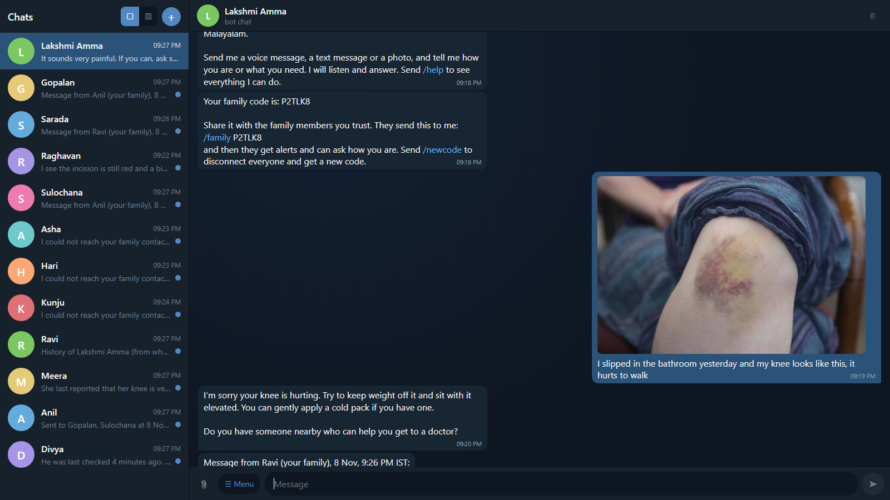
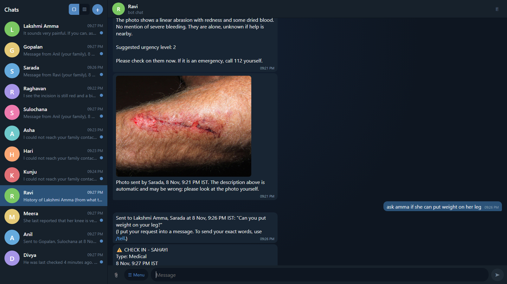
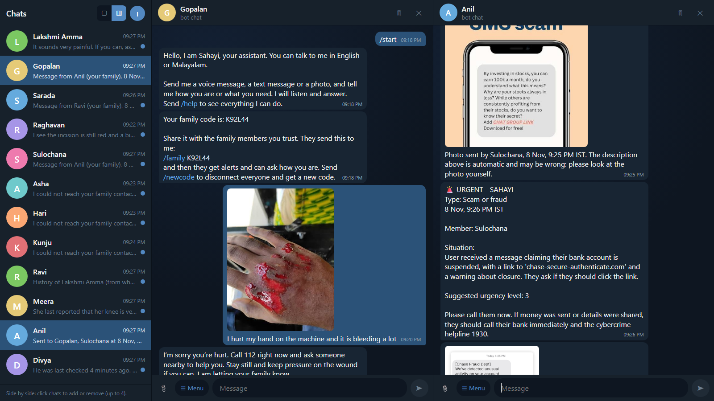
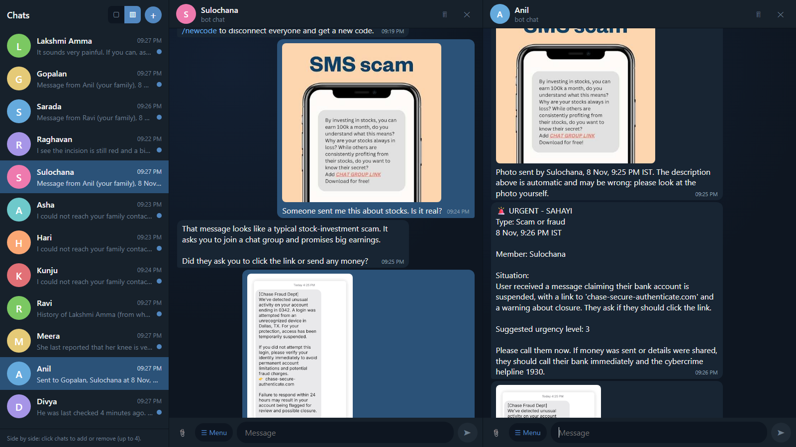
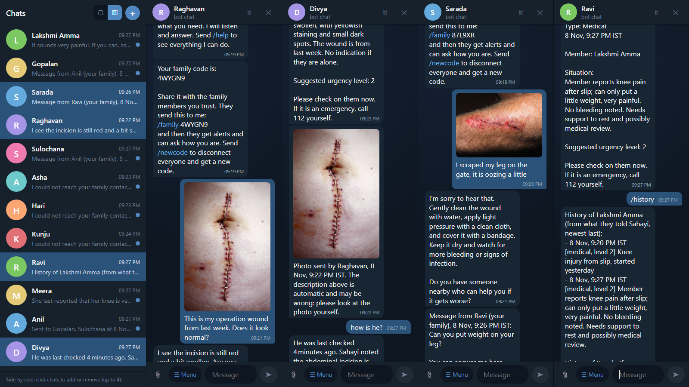
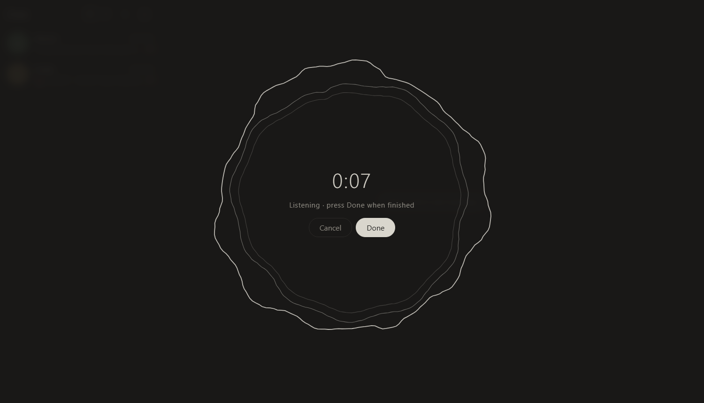
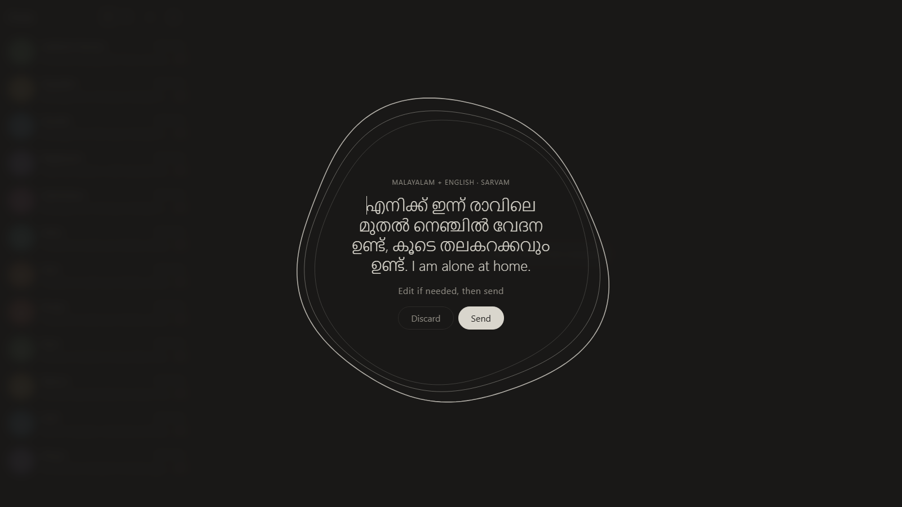
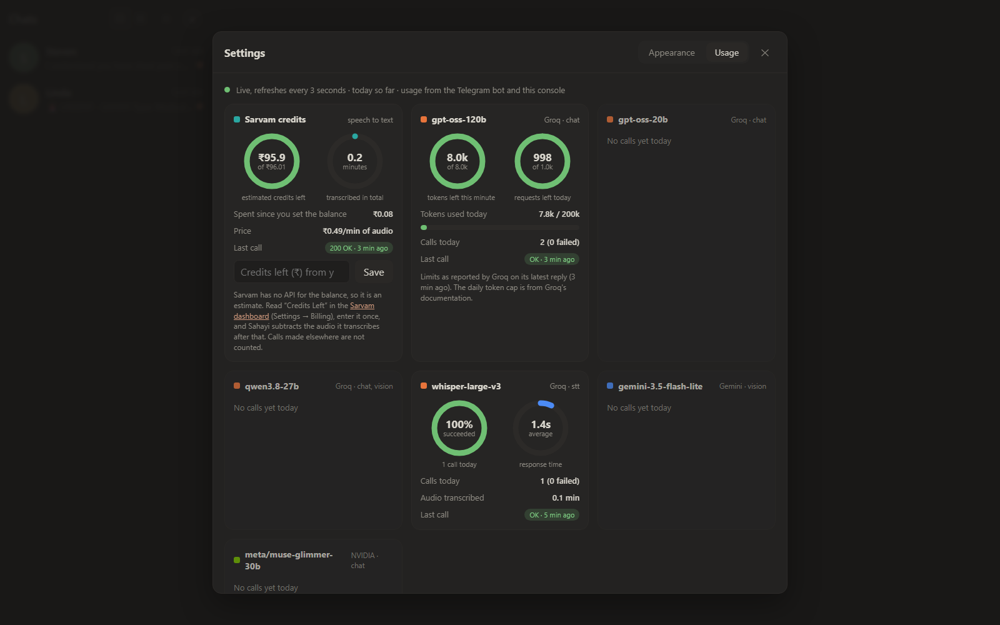
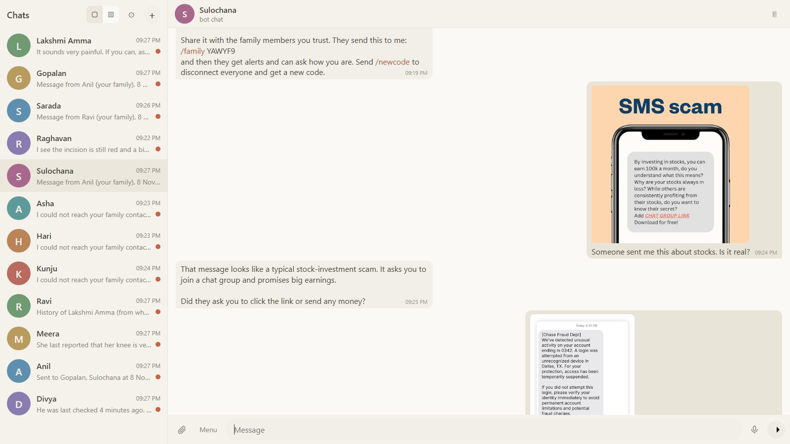
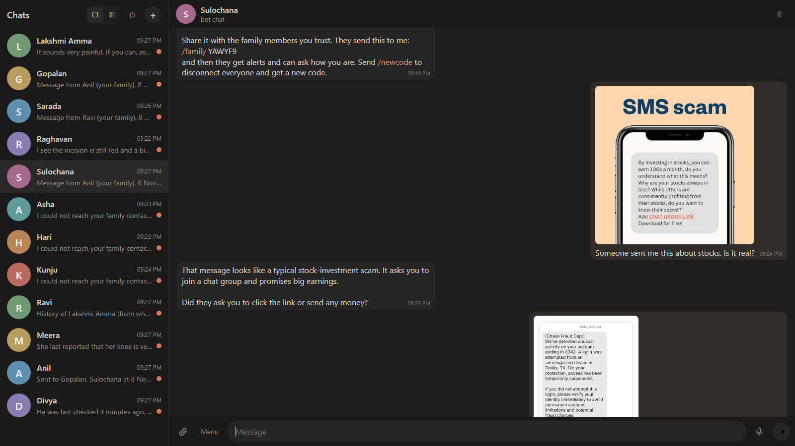

# Sahayi demo

A walkthrough of Sahayi using the built-in Telegram-style test console. Every chat below is simulated (no real people or accounts); the photos are test images.

**The cast:** *Lakshmi Amma*, *Gopalan* and *Sulochana* are seniors using Sahayi. *Ravi*, *Meera* and *Anil* are family members linked to them with a family code.

---

## 1. A senior reports an injury with a photo

Lakshmi Amma slips in the bathroom and sends a photo of her knee. Sahayi replies calmly and briefly, gives no medical advice beyond basic safety, asks one useful question, and tells her family is being informed.



## 2. Family get a typed alert and the real photo

An automatic description of a photo is not enough to judge an injury, so the family receive the **actual picture** next to the alert, labelled with the type (medical), the urgency level and the time. Ravi follows two seniors from one chat.



## 3. Family can just write, no commands needed

Ravi types "ask amma if she can put weight on her leg". Sahayi works out by meaning that this is a message for the senior, rewrites it as a direct question and delivers it. Questions like "how is she now?" are answered from the activity log. `/tell` exists for when the exact wording matters.



## 4. Scams: a different kind of emergency

Sulochana sends screenshots of two suspicious SMS messages. Sahayi reads the text in the screenshot, explains the signs of a scam, asks one question at a time, and when she says she typed her card number it escalates to an urgent alert for Anil with the screenshot attached.



## 5. Several chats at once

The console shows up to four chats side by side, so a whole family scenario can be followed on one screen.



---

## 6. Voice input

Hold the microphone button to record. A full-screen circular visualiser reacts to the voice. On release the speech is transcribed (Malayalam and mixed speech with Sarvam, English with Whisper) and the text appears in the middle of the circle with the detected language, so it can be corrected before it is sent.




## 7. Usage and themes

The gear icon opens **Settings**. The Usage tab shows live gauges for each model's remaining tokens and requests (read from Groq's response headers), an estimate of the Sarvam credits left, and calls per minute. The Appearance tab switches between four colour themes, including a softer Claude-style dark and light.





---

## What Sahayi decided on the test images

Nine test images were sent as one message each. The urgency level and type are chosen by the language model under prompt rules, so they are not guaranteed.

| Scenario | Type | Level | Notes |
|---|---|---|---|
| Hand bleeding heavily | medical | 3 | Correct. The two vision models disagreed, so the photo was flagged for human review |
| Bruised knee after a slip | medical | 2 | Debatable: the prompt treats a fall as Level 3 |
| Scraped leg | medical | 2 | Correct |
| Surgical wound with staples ("does it look normal?") | medical | 2 | Correct |
| Small palm cut | medical | 2 | Reasonable |
| Child's scraped knee | medical | 2 | Reasonable |
| Fall down stairs, face injury | medical | 2 | **Too low: should be Level 3** |
| Stock-investment SMS | scam | 2 | Correct |
| Bank phishing SMS, not yet clicked | scam | 3 | Over-cautious (expected 2) |
| "I typed my card number, it asks for an OTP" | scam | 3 | Correct |

The face-injury miss is the reason the roadmap includes a deterministic safety floor: a keyword check that forces Level 3 for clear red flags such as a fall, chest pain or a shared OTP, regardless of the model.

## Try it yourself

```powershell
cd sim-ui; npm install; npm run build; cd ..
uv run python -m bia_hackaton_2026.sim.server
```

Open http://127.0.0.1:8765, add users with the plus button, and use `/start` on a senior and `/family CODE` on a family member. Details are in the main [README](../README.md).
